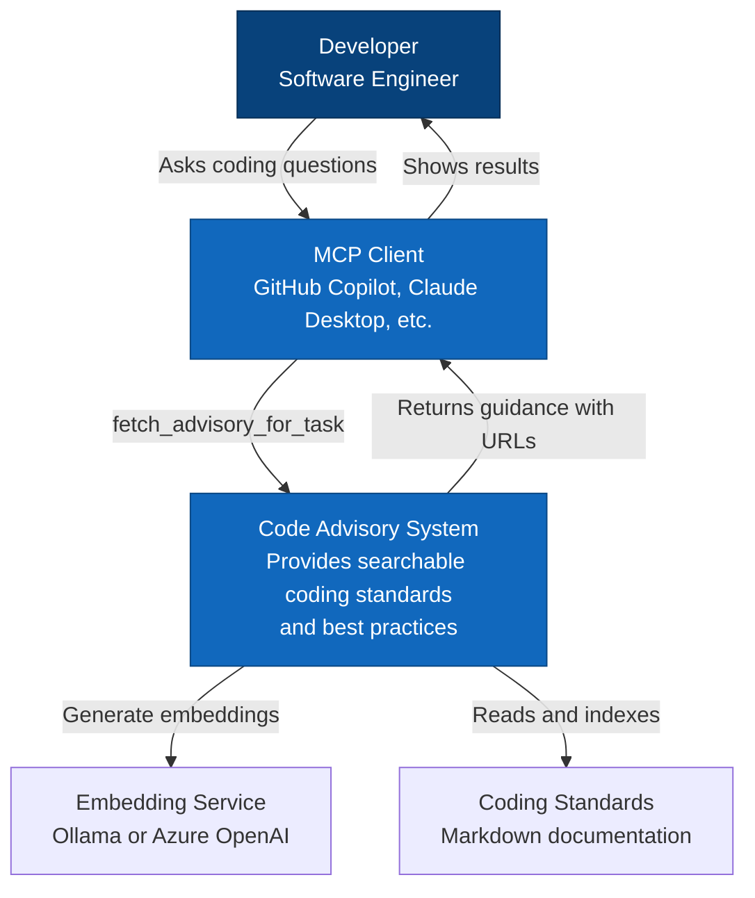
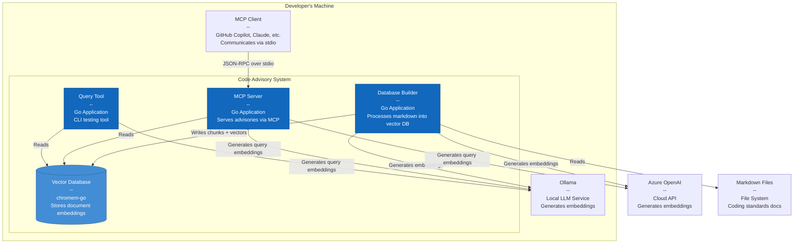
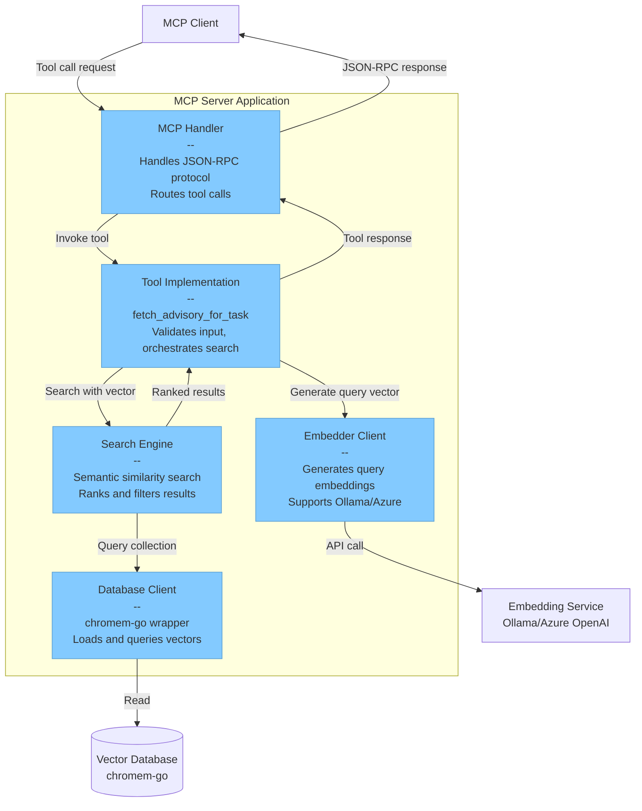
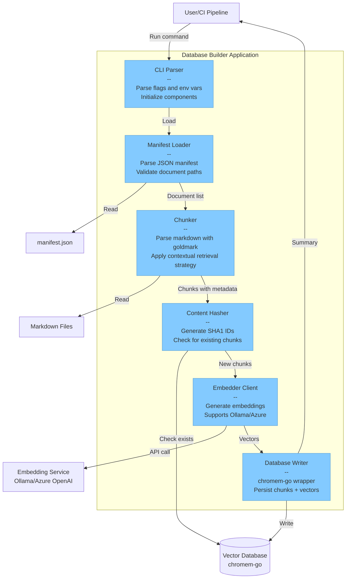
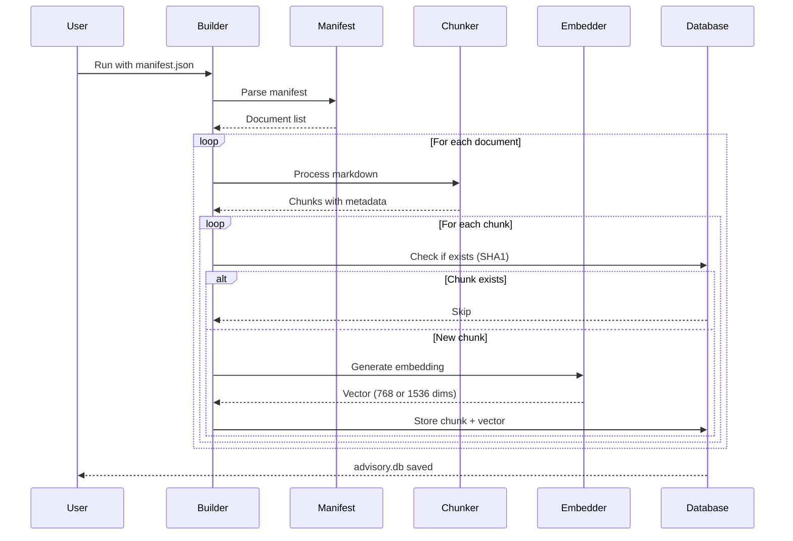
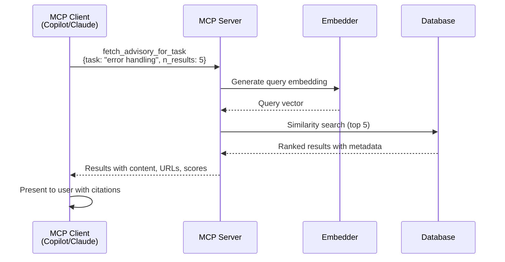
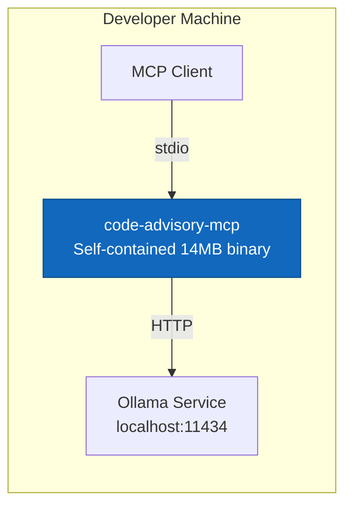
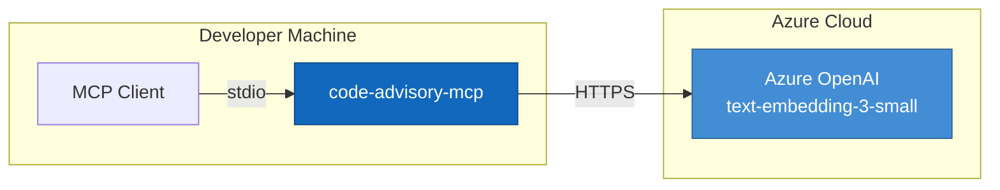

# System Architecture

This document describes the architecture of the Code Advisory MCP Server using the C4 model for progressive levels of detail.

## Overview

The Code Advisory MCP Server is a Model Context Protocol server that provides semantic search over coding standards and best practices. It consists of three main applications: Database Builder (build-time), MCP Server (runtime), and Query Tool (testing).

## C4 Architecture Diagrams

### Level 1: System Context Diagram

Shows how the Code Advisory system fits into the broader development environment.



**Key Interactions:**
- **Developer** uses an MCP client to ask coding questions
- **MCP Client** invokes the Code Advisory system via the `fetch_advisory_for_task` tool
- **Code Advisory System** generates embeddings and performs semantic search over indexed documentation
- Results are returned with deep-linked URLs to full documentation sections

### Level 2: Container Diagram

Shows the high-level technology choices and how containers communicate.



**Containers:**

1. **Database Builder** (Go Application)
   - Runs at build-time or when adding new documentation
   - Chunks markdown files using contextual retrieval strategy
   - Generates embeddings for each chunk
   - Stores in chromem-go vector database

2. **MCP Server** (Go Application)
   - Runs continuously as a stdio-based MCP server
   - Loads vector database (embedded or external file)
   - Exposes `fetch_advisory_for_task` tool
   - Performs semantic search and returns ranked results

3. **Query Tool** (Go Application)
   - CLI tool for testing the database
   - Uses same search logic as MCP Server
   - Helpful for validating database quality

4. **Vector Database** (chromem-go)
   - Pure Go vector database
   - Single file persistence (advisory.db or advisory.gob)
   - Can be embedded in binaries
   - Stores document chunks with embeddings and metadata

**External Dependencies:**
- **Ollama**: Local embedding service (nomic-embed-text model)
- **Azure OpenAI**: Cloud embedding service (text-embedding-3-small model)

### Level 3: Component Diagram - MCP Server

Shows the internal components of the MCP Server container.



**Components:**

| Component | Responsibility | Implementation |
|-----------|---------------|----------------|
| **MCP Handler** | MCP protocol implementation | `internal/mcp` package, uses go-sdk |
| **Tool Implementation** | Business logic for advisory tool | `internal/mcp/tools.go` |
| **Search Engine** | Semantic search orchestration | Wraps chromem-go similarity search |
| **Embedder Client** | Query embedding generation | `internal/embedder` with backend abstraction |
| **Database Client** | Vector DB operations | `internal/database` chromem-go wrapper |

**Request Flow:**
1. MCP Client sends JSON-RPC tool call
2. MCP Handler validates and routes to Tool Implementation
3. Tool Implementation generates query embedding via Embedder Client
4. Search Engine performs similarity search via Database Client
5. Results are ranked, filtered (top N), and returned
6. MCP Handler formats response and sends to client

### Level 3: Component Diagram - Database Builder

Shows the internal components of the Database Builder container.



**Components:**

| Component | Responsibility | Implementation |
|-----------|---------------|----------------|
| **CLI Parser** | Parse arguments and environment | `cmd/builder/main.go` |
| **Manifest Loader** | Load and validate manifest.json | `internal/manifest` package |
| **Chunker** | Split markdown into contextual chunks | `internal/chunker` package |
| **Content Hasher** | Generate SHA1 IDs, check existence | Part of builder logic |
| **Embedder Client** | Generate embeddings for chunks | `internal/embedder` package |
| **Database Writer** | Persist to chromem-go | `internal/database` package |

**Build Process:**
1. User runs builder with manifest file
2. Manifest Loader parses JSON and validates paths
3. For each document:
   - Chunker parses markdown and extracts H2+H3 sections
   - Content Hasher generates SHA1 IDs and checks if chunk exists
   - New chunks sent to Embedder Client for vector generation
   - Database Writer persists chunk + vector + metadata
4. Summary report shows added/skipped/failed chunks

**Idempotency:**
- SHA1 hash of chunk content serves as unique ID
- Before generating embedding, checks if ID exists in database
- Skips existing chunks, avoiding redundant API calls
- Allows incremental updates when adding new documents

## Data Flow Diagrams

### Database Building Sequence



### Querying via MCP



## Deployment Architectures

### Local Development (Ollama)



**Characteristics:**
- Fully local operation
- No API keys required
- Fast embedding generation (100-300ms)
- Binary includes embedded database

### Cloud Deployment (Azure OpenAI)



**Characteristics:**
- Cloud-based embeddings
- Requires API keys
- Slightly higher latency (200-500ms)
- Better for teams without local GPU resources

## Technology Stack

| Layer | Technology | Purpose | Version |
|-------|-----------|---------|---------|
| Protocol | Model Context Protocol | Standard AI tool interface | 0.1.0 |
| Language | Go | Implementation | 1.23+ |
| MCP SDK | go-sdk | MCP server implementation | Latest |
| Markdown Parser | goldmark | Document parsing | v1.7.13 |
| Vector Database | chromem-go | Semantic search | v0.7.0 |
| Embeddings (Local) | Ollama + nomic-embed-text | Local embedding generation | 768 dims |
| Embeddings (Cloud) | Azure OpenAI text-embedding-3-small | Cloud embedding generation | 1536 dims |

## Database Structure

### chromem-go Collection

```
Collection: "advisories"
├── Document 1
│   ├── ID: SHA1("## Error Handling\n...")
│   ├── Embedding: [768 or 1536 float32 values]
│   ├── Content: "## Error Handling\n\nAlways wrap..."
│   └── Metadata:
│       ├── url: "https://go.dev/doc/effective_go#error-wrapping"
│       ├── source_file: "resources/Effective-Go.md"
│       ├── h2_heading: "Error Handling"
│       ├── h3_heading: "Error Wrapping"
│       ├── language: "Go"
│       └── category: "best-practices"
└── Document N (126 total in default DB)
```

### Contextual Chunking Strategy

Each chunk contains:
- **H2 heading + content**: Parent section context
- **H3 heading + content**: Specific guidance
- **Deep-link URL**: `base_url#slugified-h3-heading`
- **Metadata**: Source file, headings, custom fields

**Example:**
```markdown
## Error Handling

Always wrap errors with context using fmt.Errorf with %w verb.

### Error Wrapping

Use fmt.Errorf("%w", err) to wrap errors:

    if err != nil {
        return fmt.Errorf("failed to connect: %w", err)
    }
```

URL: `https://go.dev/doc/effective_go#error-wrapping`

## Code Organization

```
cmd/
├── builder/        # Database builder (build-time)
├── server/         # MCP server (runtime)
│   └── embedded/   # Embedded database and instructions
├── query/          # Query tool (testing)
└── export/         # Database export utility

internal/
├── chunker/        # Markdown processing
├── embedder/       # Embedding client abstraction
├── database/       # chromem-go wrapper
├── manifest/       # Manifest parsing
└── mcp/            # MCP protocol handlers
```

## Performance Characteristics

| Operation | Latency | Notes |
|-----------|---------|-------|
| Chunking | ~100ms per document | In-memory goldmark parsing |
| Embedding (Ollama) | ~100-300ms per chunk | Local inference, CPU-bound |
| Embedding (Azure) | ~200-500ms per chunk | Network + API latency |
| Database Build | ~5-10 min for 100 docs | Depends on backend and chunks |
| Query Embedding | ~100-300ms | Same as document embedding |
| Vector Search | ~10-50ms | In-memory cosine similarity |
| Total Query Latency | ~150-400ms | End-to-end response time |

## Security Considerations

1. **API Keys**: Environment variables only, never logged
2. **Input Validation**: Task string length limited
3. **Path Sanitization**: Manifest paths validated
4. **No Network Exposure**: stdio-only, no HTTP server
5. **Local Option**: Ollama requires no external API keys

## Scalability

| Dimension | Current | Limit | Notes |
|-----------|---------|-------|-------|
| Documents | 4 | 1000+ | Limited by API costs and build time |
| Chunks | 126 | 10,000+ | chromem-go in-memory limit |
| Binary Size | 14MB | 50MB | Embedded database size constraint |
| Query Results | 25 max | - | Configurable per query (1-25) |
| Concurrent Queries | 1 | 1 | Single-threaded MCP server |

## Future Enhancements

### Phase 4: Advanced Features
- Multi-database support (per language/team)
- Caching layer for frequent queries
- Metadata filtering (language, category, version)
- Query analytics and telemetry

### Phase 5: Production Hardening
- Prometheus metrics endpoint
- Health check mechanism
- Hot-reload database updates
- Concurrent query support

### Phase 6: UI/Administration
- Web UI for database management
- Visual query testing interface
- Document upload and indexing
- Usage analytics dashboard

## References

- [C4 Model](https://c4model.com/) - Architecture visualization
- [MCP Protocol Specification](https://github.com/modelcontextprotocol/specification)
- [chromem-go Documentation](https://github.com/philippgille/chromem-go)
- [Ollama Documentation](https://ollama.ai/docs)
- [Azure OpenAI Documentation](https://learn.microsoft.com/en-us/azure/ai-services/openai/)
- [goldmark Documentation](https://github.com/yuin/goldmark)
